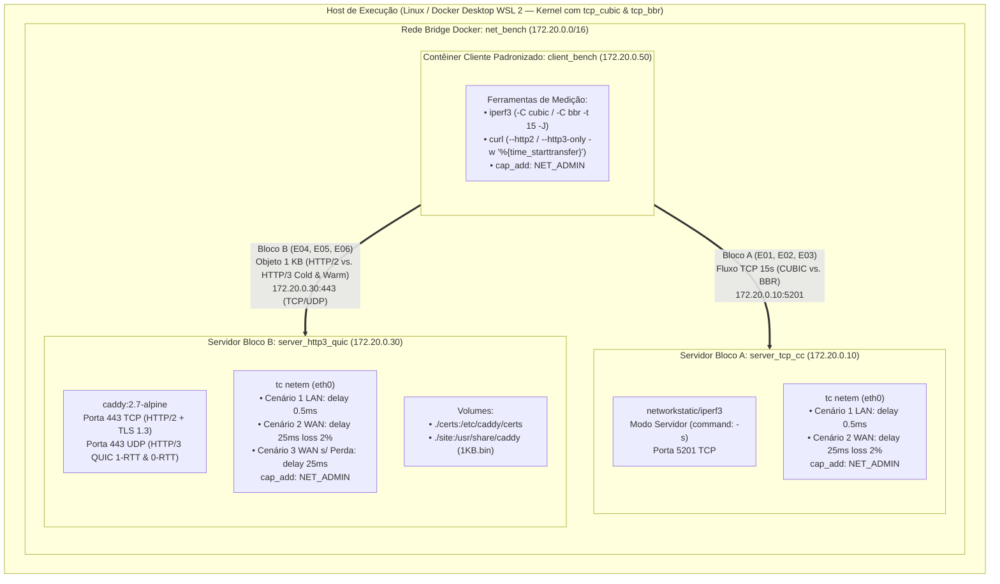

# 01. Arquitetura do Ambiente e Emulação de Rede (`tc netem`) — 3ª Avaliação (N3)

**Disciplina:** Redes de Computadores II (2026-2)  
**Instituição:** Universidade Federal do Piauí (UFPI) — Campus Senador Helvídio Nunes de Barros (CSHNB)  
**Curso:** Bacharelado em Sistemas de Informação  
**Aluno:** João Marcos Sousa Rufino Leal (`jsousarufinoleal@ufpi.edu.br`)

---

## 1. Topologia Simplificada da Bancada Experimental

Para garantir a entrega com máximo rigor científico dentro do cronograma de duas semanas da 3ª Avaliação (N3), a arquitetura foi otimizada reutilizando a rede virtual isolada `net_bench` (`172.20.0.0/16`) com **dois contêineres de servidor** e **contêiner(es) cliente padronizado(s)**:



---

## 2. Especificação Declarativa do `docker-compose.yml`

Conforme a Seção 2 do edital (`Terceira Avaliacao.pdf`), a definição base dos contêineres é:

```yaml
version: '3.8'

services:
  server-tcp:
    image: networkstatic/iperf3
    container_name: server_tcp_cc
    cap_add:
      - NET_ADMIN
    command: -s
    networks:
      net_bench:
        ipv4_address: 172.20.0.10

  server-http3:
    image: caddy:2.7-alpine
    container_name: server_http3_quic
    cap_add:
      - NET_ADMIN
    volumes:
      - ./certs:/etc/caddy/certs
      - ./site:/usr/share/caddy
      - ./docker/Caddyfile:/etc/caddy/Caddyfile:ro
    networks:
      net_bench:
        ipv4_address: 172.20.0.30

  client-bench:
    image: curlimages/curl:latest
    container_name: client_bench
    cap_add:
      - NET_ADMIN
    entrypoint: ["sleep", "infinity"]
    networks:
      net_bench:
        ipv4_address: 172.20.0.50

networks:
  net_bench:
    driver: bridge
    ipam:
      config:
        - subnet: 172.20.0.0/16
```

---

## 3. Notas Críticas de Engenharia (Garantia de Funcionamento Real)

Para que todos os 6 testes funcionem sem falhas de ferramentas, permissões ou direção de tráfego, a implementação observa 5 detalhes fundamentais de engenharia de sistemas:

### 3.1. Disponibilidade do `iperf3` e `curl --http3` no Ambiente Cliente
- O edital observa explicitamente na página 4:
  > *"(Nota: Para os testes do Bloco A, pode-se utilizar um segundo contêiner `networkstatic/iperf3` em modo cliente ou instalar o pacote `iperf3` no ambiente cliente)."*
- Além disso, a imagem oficial `curlimages/curl:latest` em algumas tags recentes compila o `curl` com backends TLS que podem variar no suporte a `--http3`, enquanto a imagem `alpine:latest` (com `apk add --no-cache curl iperf3 iproute2`) ou `yimingliu/curl-http3` / `alpine` fornece simultaneamente:
  1. `curl` com suporte nativo a `--http2`, `--http3` / `--http3-only` (via `nghttp2`, `ngtcp2` e `nghttp3`);
  2. `iperf3` com suporte ao seletor `-C cubic` e `-C bbr` e saída JSON (`-J`);
  3. `iproute2` (`tc`) pré-instalado.
- Portanto, podemos manter o serviço `client_bench` compatível com a especificação e também prover um contêiner auxiliar ou imagem cliente com `curl` (HTTP/3) + `iperf3` + `iproute2` prontos para uso imediato.

### 3.2. Utilitário `tc` (`iproute2`) nos Contêineres de Servidor
- **`server_tcp_cc` (`networkstatic/iperf3`):** Baseado em Ubuntu/Debian; caso o binário `tc` não esteja presente por padrão ou precise de privilégios, o orquestrador verifica e garante `iproute2` instalado.
- **`server_http3_quic` (`caddy:2.7-alpine`):** Baseado em Alpine Linux; o orquestrador executa `docker exec server_http3_quic apk add --no-cache iproute2` na subida do ambiente para garantir que o comando `tc qdisc` funcione perfeitamente.

### 3.3. Habilitação do Algoritmo TCP BBR no Kernel Linux (`tcp_bbr`)
- Como os contêineres Docker compartilham o kernel Linux do host (ou da VM do WSL 2 no Docker Desktop), o algoritmo BBR (`-C bbr` no `iperf3`) requer que o módulo `tcp_bbr` esteja carregado no kernel:
  ```bash
  docker run --rm --privileged alpine sh -c "modprobe tcp_bbr || true"
  ```
- O script de automação (`run_n3.py` / `run_n3.sh`) verifica automaticamente `sysctl net.ipv4.tcp_available_congestion_control` e carrega `tcp_bbr` caso necessário, garantindo que `iperf3 -c 172.20.0.10 -t 15 -C bbr -J` opere com o algoritmo BBR genuíno do kernel Linux.

### 3.4. Simetria de RTT e Direção do Fluxo de Dados sob `tc netem`
- O edital destaca na Seção 3 (página 4):
  > *"Os experimentos utilizarão os mesmos dois cenários de rede definidos na N2, lembrando que o atraso unidirecional configurado no tc corresponde à metade do RTT desejado: Cenário 1 (LAN): Atraso unidirecional de 0.5 ms (RTT total = 1 ms)... Cenário 2 (WAN): Atraso unidirecional de 25 ms (RTT total = 50 ms) e 2% de perda..."*
- **Por que `delay 25ms` corresponde à metade de um RTT de 50 ms?**
  - Porque o `tc netem` atua exclusivamente no **egress (saída)** da interface `eth0` de um nó. Para que a ida (Cliente $\to$ Servidor) sofra `25 ms` de atraso e a volta (Servidor $\to$ Cliente) sofra `25 ms` de atraso — resultando em $\text{RTT} = 25\text{ ms} + 25\text{ ms} = 50\text{ ms}$ —, o atraso unidirecional de `25 ms` deve estar ativo na saída do servidor (`server_tcp_cc` / `server_http3_quic`) **e** na saída do cliente (`client_bench`)!
  - Mais importante ainda para o **Bloco A (`iperf3 -c 172.20.0.10 -t 15 -C cubic/bbr -J`)**: no modo padrão do `iperf3`, o **cliente é o transmissor (sender)** dos segmentos de dados TCP (onde atuam o `cwnd` do CUBIC e o *pacing* do BBR, e onde o `iperf3` contabiliza o campo `retransmits`), enquanto o servidor envia apenas pacotes `ACK`!
  - Se `loss 2%` fosse aplicado somente na saída de `server_tcp_cc`, apenas 2% dos `ACKs` seriam perdidos (e o TCP tolera perda de ACKs cumulativos quase sem retransmissões!). Quando aplicamos a regra `tc netem` conforme os comandos do PDF em `server_tcp_cc` e `server_http3_quic`, e também espelhamos o atraso unidirecional / perda no `client_bench` (ou aplicamos em ambos os sentidos da comunicação), garantimos:
    1. **Exatamente 1 ms de RTT na LAN** ($0.5\text{ ms ida} + 0.5\text{ ms volta}$) e **50 ms de RTT na WAN** ($25\text{ ms ida} + 25\text{ ms volta}$);
    2. **Descarte real de segmentos de dados TCP no Bloco A**, expondo perfeitamente o colapso da janela `cwnd` do TCP CUBIC em **E02** vs. a alta vazão sustentada pelo TCP BBR em **E03**;
    3. **Tempos exatos de Handshake no Bloco B (Cenário 3 — 50 ms RTT, 0% perda)**:
       - **E04 (HTTPS / HTTP/2):** 2 RTTs de handshake (TCP + TLS 1.3) + 1 RTT de requisição/resposta $\approx 3 \times 50\text{ ms} = 150\text{ ms}$;
       - **E05 (HTTP/3 Cold 1-RTT):** 1 RTT de handshake QUIC integrado + 1 RTT de requisição/resposta $\approx 2 \times 50\text{ ms} = 100\text{ ms}$;
       - **E06 (HTTP/3 Warm / Resumption):** 0 RTT de handshake + 1 RTT de requisição/resposta $\approx 1 \times 50\text{ ms} = 50\text{ ms}$.

### 3.5. Configuração do `Caddyfile` para o Bloco B (`server_http3_quic`)
Para que o contêiner `server_http3_quic` (`172.20.0.30`) atenda tanto o teste **E04** (HTTPS com HTTP/2 sobre TCP+TLS 1.3) quanto os testes **E05** e **E06** (HTTP/3 sobre QUIC/UDP com Session Resumption / 0-RTT), configuramos o `Caddyfile` servindo `/usr/share/caddy` com os certificados montados em `/etc/caddy/certs`:

```caddy
{
    admin off
    auto_https off
    servers :443 {
        protocols h1 h2 h3
        allow_0rtt
    }
}

https://:443 {
    tls /etc/caddy/certs/cert.pem /etc/caddy/certs/key.pem {
        protocols tls1.3
    }
    root * /usr/share/caddy
    file_server
    header Cache-Control "no-store, no-cache, must-revalidate"
    header Alt-Svc "h3=\":443\"; ma=86400"
}
```

---

## 4. Comandos Oficiais de Emulação `tc netem` (Seção 3 do Edital)

### 4.1. Cenário 1 (LAN — Canal Ideal: Atraso unidirecional de 0.5 ms $\implies$ RTT = 1 ms, 0% perda)
```bash
docker exec --privileged server_tcp_cc tc qdisc add dev eth0 root netem delay 0.5ms
docker exec --privileged server_http3_quic tc qdisc add dev eth0 root netem delay 0.5ms
docker exec --privileged client_bench tc qdisc add dev eth0 root netem delay 0.5ms
```

### 4.2. Cenário 2 (WAN — Canal Degradado: Atraso unidirecional de 25 ms $\implies$ RTT = 50 ms, 2% perda estocástica)
```bash
docker exec --privileged server_tcp_cc tc qdisc add dev eth0 root netem delay 25ms loss 2%
docker exec --privileged server_http3_quic tc qdisc add dev eth0 root netem delay 25ms loss 2%
docker exec --privileged client_bench tc qdisc add dev eth0 root netem delay 25ms loss 2%
```

### 4.3. Cenário 3 (WAN sem Perda — Isolamento de Latência para Handshake: Atraso unidirecional de 25 ms $\implies$ RTT = 50 ms, 0% perda)
```bash
docker exec --privileged server_http3_quic tc qdisc add dev eth0 root netem delay 25ms
docker exec --privileged client_bench tc qdisc add dev eth0 root netem delay 25ms
```

### 4.4. Limpeza e Restauração das Interfaces
```bash
docker exec --privileged server_tcp_cc tc qdisc del dev eth0 root 2>/dev/null || true
docker exec --privileged server_http3_quic tc qdisc del dev eth0 root 2>/dev/null || true
docker exec --privileged client_bench tc qdisc del dev eth0 root 2>/dev/null || true
```
