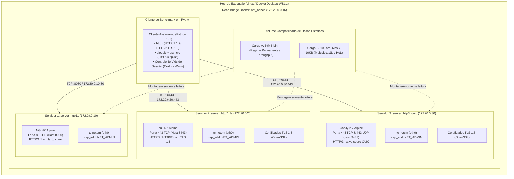

# 01. Arquitetura de Rede e Infraestrutura Docker

**Disciplina:** Redes de Computadores II (2026-2)  
**Instituição:** Universidade Federal do Piauí (UFPI) — Campus Senador Helvídio Nunes de Barros (CSHNB)  
**Curso:** Bacharelado em Sistemas de Informação  
**Aluno:** João Marcos Sousa Rufino Leal (`jsousarufinoleal@ufpi.edu.br`)

---

## 1. Topologia da Rede Experimental

Para isolar os experimentos de interferências de tráfego externo, oscilações de roteamento e comportamentos imprevisíveis de caches locais de sistema operacional, a infraestrutura é integralmente modelada em contêineres Docker, interconectados por uma rede bridge dedicada com endereçamento IPv4 estático.



---

## 2. Especificação Declarativa do `docker-compose.yml`

Conforme especificado no edital da 2ª Avaliação, o ambiente orquestra três contêineres de servidores distintos:

```yaml
version: '3.8'

services:
  server-http1:
    image: nginx:alpine
    container_name: server_http11
    cap_add:
      - NET_ADMIN
    ports:
      - "8080:80"
    volumes:
      - ./server-http1/nginx.conf:/etc/nginx/nginx.conf:ro
      - ../data/static:/usr/share/nginx/html:ro
    networks:
      net_bench:
        ipv4_address: 172.20.0.10

  server-http2:
    image: nginx:alpine
    container_name: server_http2_tls
    cap_add:
      - NET_ADMIN
    ports:
      - "8443:443"
    volumes:
      - ./server-http2/nginx.conf:/etc/nginx/nginx.conf:ro
      - ./certs:/etc/nginx/certs:ro
      - ../data/static:/usr/share/nginx/html:ro
    networks:
      net_bench:
        ipv4_address: 172.20.0.20

  server-http3:
    image: caddy:2.7-alpine
    container_name: server_http3_quic
    cap_add:
      - NET_ADMIN
    ports:
      - "9443:443/tcp"
      - "9443:443/udp"
    volumes:
      - ./server-http3/Caddyfile:/etc/caddy/Caddyfile:ro
      - ./certs:/etc/caddy/certs:ro
      - ../data/static:/var/www/html:ro
    networks:
      net_bench:
        ipv4_address: 172.20.0.30

networks:
  net_bench:
    driver: bridge
    ipam:
      config:
        - subnet: 172.20.0.0/16
```

---

## 3. Detalhamento dos Três Servidores Web

### 3.1. Servidor 1: HTTP/1.1 em Texto Claro (`server_http11`)
- **Software:** NGINX Alpine (`nginx:alpine`).
- **Porta:** 80 internamente / 8080 exposta no host.
- **Endereço IPv4 na rede Docker:** `172.20.0.10`.
- **Objetivo Científico:** Servir como linha de base (*baseline*) pura de desempenho do protocolo de transporte TCP sem o overhead de criptografia simétrica ou assimétrica do TLS. Permite isolar o custo real do 3-way handshake do TCP (1 RTT) e a vulnerabilidade ao Head-of-Line Blocking na camada de aplicação.
- **Configuração de Referência (`nginx.conf`):**
  ```nginx
  events { worker_connections 1024; }
  http {
      include /etc/nginx/mime.types;
      default_type application/octet-stream;
      sendfile on;
      tcp_nopush on;
      tcp_nodelay on;
      keepalive_timeout 65;

      server {
          listen 80;
          server_name localhost;
          root /usr/share/nginx/html;

          location / {
              try_files $uri $uri/ =404;
              add_header Cache-Control "no-store, no-cache, must-revalidate";
          }
      }
  }
  ```

### 3.2. Servidor 2: HTTPS / HTTP/2 com TLS 1.3 (`server_http2_tls`)
- **Software:** NGINX Alpine (`nginx:alpine`).
- **Porta:** 443 internamente / 8443 exposta no host.
- **Endereço IPv4 na rede Docker:** `172.20.0.20`.
- **Objetivo Científico:** Avaliar o impacto cumulativo do handshake duplo (TCP 1 RTT + TLS 1.3 1 RTT = 2 RTTs) no TTFB e analisar a multiplexação por quadros binários do HTTP/2. Evidencia empiricamente o fenômeno em que a resolução do HoL blocking na aplicação transfere a vulnerabilidade para a camada de transporte TCP, onde a perda de um único segmento no Cenário WAN retém o buffer de todos os fluxos multiplexados.
- **Configuração de Referência (`nginx.conf`):**
  ```nginx
  events { worker_connections 1024; }
  http {
      include /etc/nginx/mime.types;
      default_type application/octet-stream;
      sendfile on;
      tcp_nopush on;
      tcp_nodelay on;

      server {
          listen 443 ssl http2;
          server_name localhost;
          root /usr/share/nginx/html;

          ssl_certificate /etc/nginx/certs/cert.pem;
          ssl_certificate_key /etc/nginx/certs/key.pem;
          ssl_protocols TLSv1.3;
          ssl_prefer_server_ciphers off;

          location / {
              try_files $uri $uri/ =404;
              add_header Cache-Control "no-store, no-cache, must-revalidate";
          }
      }
  }
  ```

### 3.3. Servidor 3: HTTP/3 Nativo sobre QUIC (`server_http3_quic`)
- **Software:** Caddy 2.7 Alpine (`caddy:2.7-alpine`).
- **Portas:** 443/tcp e 443/udp internamente / 9443:443/tcp e 9443:443/udp no host.
- **Endereço IPv4 na rede Docker:** `172.20.0.30`.
- **Objetivo Científico:** Mensurar a eficiência do transporte QUIC sobre datagramas UDP com handshake integrado de 1 RTT e streams independentes. Demonstra a imunidade ao HoL blocking tanto na aplicação quanto no transporte, sustentando alta taxa de requisições por segundo (RPS) sob o Cenário WAN (2% de perda estocástica e 50ms de RTT).
- **Configuração de Referência (`Caddyfile`):**
  ```caddy
  {
      admin off
      auto_https off
      servers {
          protocol {
              experimental_http3
          }
      }
  }

  https://:443 {
      tls /etc/caddy/certs/cert.pem /etc/caddy/certs/key.pem
      root * /var/www/html
      file_server
      header Cache-Control "no-store, no-cache, must-revalidate"
      header Alt-Svc "h3=\":9443\"; ma=86400"
  }
  ```

---

## 4. Geração dos Certificados TLS 1.3 Locais com SANs Válidos

Para que os clientes assíncronos em Python (`httpx` e `aioquic`) estabeleçam conexões seguras sem falhas de resolução de nome ou rejeição de certificado inválido, geramos um par de chaves e certificado autoassinado com extensões **Subject Alternative Name (SAN)** cobrindo todos os endereços utilizados:

```bash
#!/usr/bin/env bash
set -euo pipefail

mkdir -p certs

openssl req -x509 -newkey rsa:2048 -nodes \
  -keyout certs/key.pem \
  -out certs/cert.pem \
  -days 365 \
  -subj "/C=BR/ST=Piaui/L=Picos/O=UFPI/OU=RedesII/CN=localhost" \
  -addext "subjectAltName=DNS:localhost,DNS:server_http2_tls,DNS:server_http3_quic,IP:127.0.0.1,IP:172.20.0.20,IP:172.20.0.30"

echo "Certificados TLS 1.3 gerados com sucesso em ./certs/"
```

---

## 5. Emulação de Rede com Linux Traffic Control (`tc netem`)

### 5.1. Permissões de Kernel e RTNETLINK
A manipulação de disciplinas de enfileiramento (*Queueing Disciplines* - `qdisc`) requer privilégios de administração de rede no kernel Linux. A declaração `cap_add: - NET_ADMIN` em cada contêiner no `docker-compose.yml` concede a capability `CAP_NET_ADMIN`, essencial para que o utilitário `tc` injete atrasos e descartes na interface virtual `eth0` do contêiner sem o erro:
`RTNETLINK answers: Operation not permitted`.

### 5.2. Cálculo do RTT no `tc netem`
O comando `tc netem delay Xms` aplica o atraso na saída de pacotes da interface. Em uma comunicação de ida e volta (Round-Trip Time - RTT), o tempo total é a soma do tempo de envio da requisição mais o tempo de envio da resposta. Portanto:
$$\text{RTT} = 2 \times \text{delay}_{\text{netem}} \implies \text{delay}_{\text{netem}} = \frac{\text{RTT}}{2}$$

- **Cenário 1 (LAN - RTT de 1.0 ms):** $\text{delay} = 1.0 / 2 = 0.5\text{ ms}$, Perda: $0\%$.
- **Cenário 2 (WAN - RTT de 50.0 ms):** $\text{delay} = 50.0 / 2 = 25.0\text{ ms}$, Perda: $2\%$.

### 5.3. Comandos Padronizados de Execução e Limpeza

```bash
# ==============================================================================
# Aplicação do Cenário 1 (LAN - Latência RTT de 1ms, 0% Perda):
# ==============================================================================
docker exec --privileged server_http11 tc qdisc add dev eth0 root netem delay 0.5ms
docker exec --privileged server_http2_tls tc qdisc add dev eth0 root netem delay 0.5ms
docker exec --privileged server_http3_quic tc qdisc add dev eth0 root netem delay 0.5ms

# ==============================================================================
# Aplicação do Cenário 2 (WAN - Latência RTT de 50ms, 2% de Perda Estocástica):
# ==============================================================================
docker exec --privileged server_http11 tc qdisc add dev eth0 root netem delay 25ms loss 2%
docker exec --privileged server_http2_tls tc qdisc add dev eth0 root netem delay 25ms loss 2%
docker exec --privileged server_http3_quic tc qdisc add dev eth0 root netem delay 25ms loss 2%

# ==============================================================================
# Limpeza e Restauração das Interfaces (Estado Limpo):
# ==============================================================================
docker exec --privileged server_http11 tc qdisc del dev eth0 root 2>/dev/null || true
docker exec --privileged server_http2_tls tc qdisc del dev eth0 root 2>/dev/null || true
docker exec --privileged server_http3_quic tc qdisc del dev eth0 root 2>/dev/null || true
```
