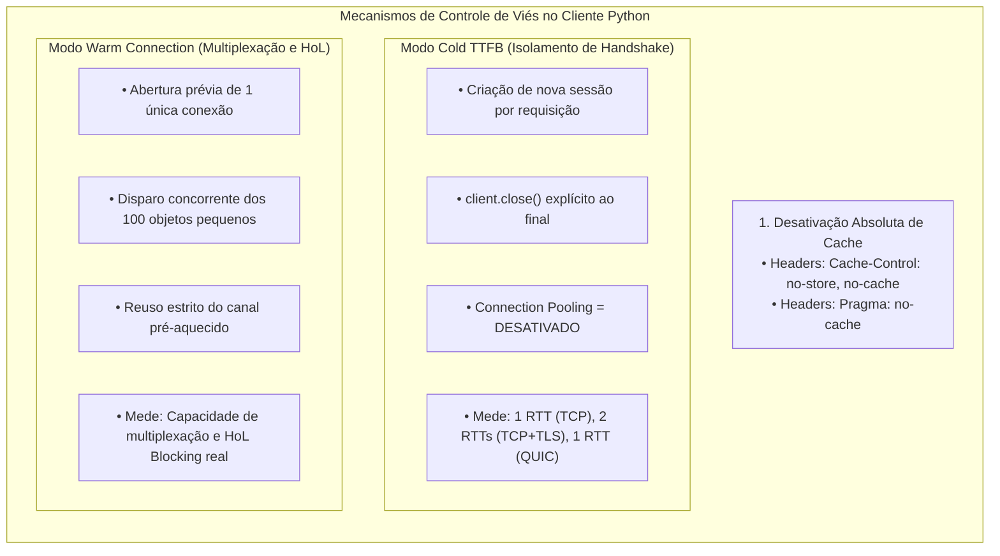

# 03. Métricas de Desempenho, Análise Estatística e Controle de Viés

**Disciplina:** Redes de Computadores II (2026-2)  
**Instituição:** Universidade Federal do Piauí (UFPI) — Campus Senador Helvídio Nunes de Barros (CSHNB)  
**Curso:** Bacharelado em Sistemas de Informação  
**Aluno:** João Marcos Sousa Rufino Leal (`jsousarufinoleal@ufpi.edu.br`)

Este documento estabelece a modelagem matemática das métricas operacionais, as regras de controle de viés de sessão no cliente Python, o tratamento estatístico com intervalos de confiança e as diretrizes obrigatórias para os gráficos científicos.

---

## 1. Mapeamento das Métricas Operacionais

O cliente de benchmark em Python (`benchmark/client.py`) deve coletar dados temporais com **precisão de microssegundos** utilizando timers monotônicos de alta resolução (`time.perf_counter()`):

### 1.1. Time to First Byte (TTFB)
- **Definição:** Intervalo de tempo transcorrido entre a emissão do primeiro byte do cabeçalho da requisição pelo cliente e a recepção do primeiro byte do corpo (*payload*) da resposta vinda do servidor:
  $$\text{TTFB} = t_{\text{first\_byte\_received}} - t_{\text{request\_started}}$$
- **Significado Científico:** Em conexões frias (*Cold TTFB*), o TTFB quantifica diretamente o custo de latência de estabelecimento da conexão (handshakes de transporte e criptografia):
  - **HTTP/1.1:** 1 RTT (Handshake de 3 vias TCP: SYN $\to$ SYN-ACK $\to$ ACK) + tempo de processamento do servidor;
  - **HTTPS / HTTP/2:** 2 RTTs cumulativos (1 RTT TCP + 1 RTT TLS 1.3);
  - **HTTP/3-QUIC:** 1 RTT integrado (QUIC + TLS 1.3 embutido sobre UDP) ou 0-RTT em conexões subsequentes.

### 1.2. Tempo Total de Carregamento (Total Load Time)
- **Definição:** Duração total decorrida desde a inicialização do pedido até a recepção completa do último byte do recurso solicitado:
  $$\text{Total Load Time} = t_{\text{last\_byte\_received}} - t_{\text{request\_started}}$$
- **Cálculo da Vazão Útil (Goodput):**  
  Para a Carga A (50 MB), a vazão útil efetiva de aplicação é dada por:
  $$\text{Goodput (Mbps)} = \frac{\text{Bytes Úteis de Aplicação} \times 8}{\text{Total Load Time (segundos)} \times 10^6}$$

### 1.3. Requisições por Segundo (RPS)
- **Definição:** Razão entre a quantidade total de requisições concluídas com código de status HTTP `200 OK` e a duração total da janela de execução do teste da Carga B (100 objetos):
  $$\text{RPS} = \frac{N_{\text{requisições\_sucesso}}}{\Delta t_{\text{janela\_total\_teste}}}$$
- **Significado Científico:** Mede a capacidade de multiplexação de conexões concorrentes. No Cenário WAN sob 2% de perda, o RPS do HTTP/3 demonstrará superioridade expressiva em relação ao HTTP/2 e ao HTTP/1.1 devido ao isolamento de perdas por stream.

### 1.4. Percentis de Latência (p50 e p99)
- **Percentil p50 (Mediana):** Valor central da distribuição de tempo de resposta. Representa a experiência típica da maioria das requisições, sendo robusto contra outliers.
- **Percentil p99 (Cauda Longa / Pior Caso):** Limite de latência para 99% das requisições amostradas. É a métrica mais sensível para revelar o impacto do **Head-of-Line (HoL) Blocking** e retransmissões:
  - No HTTP/2 com perda de 2% (T11), o p99 dispara porque a retransmissão do pacote TCP atrasa a entrega de todo o buffer da aplicação.
  - No HTTP/3 (T12), o p99 permanece estreito, pois streams não afetados pela perda progridem imediatamente.

---

## 2. Controle Estrito de Viés de Sessão (Client-Side Bias Control)

> [!WARNING]
> ### SANÇÃO DO EDITAL (-10 PONTOS):
> A inobservância do controle de viés de sessão (como o reuso indevido de conexões no teste de TTFB) acarreta a **subtração direta de 10 pontos na nota final**.

Para assegurar rigor metodológico, o cliente de benchmark implementa dois modos operacionais mutualmente exclusivos:



1. **Desativação Total de Cache:** O cliente Python não armazena cookies, respostas em memória ou em disco. Todas as requisições incluem cabeçalhos explícitos `Cache-Control: no-cache, no-store`.
2. **Modo Conexão Fria (Cold TTFB):**
   - Utilizado para medir com precisão a latência inicial de handshake.
   - Antes de cada requisição individual, uma nova instância do cliente é criada e, imediatamente após a recepção do primeiro byte/resposta, a sessão é explicitamente destruída com `await client.aclose()`.
   - Impede o reaproveitamento de sockets TCP ou conexões QUIC prévias.
3. **Modo Conexão Aquecida (Warm Connection):**
   - Utilizado nos testes da Carga B (100 objetos de 10 KB).
   - O cliente estabelece uma única conexão persistente e dispara as requisições concorrentes sobre essa mesma conexão aquecida.
   - Permite mensurar a eficiência real de divisão de canal por quadros no HTTP/2 e por streams no HTTP/3, sem a contaminação do custo de sucessivos handshakes.

---

## 3. Rigor Estatístico Obrigatório ($N \ge 10$)

Para mitigar variações estocásticas do agendador de processos do sistema operacional e da emulação de pacotes, cada ponto de teste possui no mínimo **10 repetições independentes** ($N = 10$).

### 3.1. Estimadores Estatísticos
Para cada conjunto amostral $X = \{x_1, x_2, \dots, x_N\}$ coletado:
- **Média Amostral ($\bar{x}$):**
  $$\bar{x} = \frac{1}{N} \sum_{i=1}^{N} x_i$$
- **Variância Amostral ($s^2$):**
  $$s^2 = \frac{1}{N - 1} \sum_{i=1}^{N} (x_i - \bar{x})^2$$
- **Desvio Padrão Amostral ($s$):**
  $$s = \sqrt{s^2}$$

### 3.2. Intervalo de Confiança de 95% (Distribuição t-Student)
Como o tamanho da amostra é pequeno ($N = 10 < 30$) e o desvio padrão populacional é desconhecido, utiliza-se a distribuição **t-Student** com $\nu = N - 1 = 9$ graus de liberdade:
$$CI_{95\%} = \left[ \bar{x} - t_{\alpha/2, \nu} \times \frac{s}{\sqrt{N}}, \quad \bar{x} + t_{\alpha/2, \nu} \times \frac{s}{\sqrt{N}} \right]$$
Para $\alpha = 0.05$ (confiança de 95%) e $\nu = 9$:
$$t_{0.025, 9} \approx 2.262$$
A margem de erro ($ME$) é dada por:
$$ME = 2.262 \times \frac{s}{\sqrt{10}} \approx 0.715 \times s$$

---

## 4. Esquema de Exportação de Dados Brutos (`results.json` e `results.csv`)

Ao término dos ensaios, o cliente exporta os registros estruturados para `data/raw/`:

### 4.1. Estrutura do `results.json`
```json
[
  {
    "test_id": "T01",
    "repetition": 1,
    "timestamp": "2026-10-21T11:00:00.123456Z",
    "protocol": "HTTP/1.1",
    "scenario": "LAN",
    "load_profile": "Carga A (50MB)",
    "rtt_emulated_ms": 1.0,
    "loss_emulated_pct": 0.0,
    "status_code": 200,
    "ttfb_ms": 1.254,
    "total_load_time_ms": 412.305,
    "bytes_transferred": 52428800,
    "goodput_mbps": 1017.25,
    "rps": null
  }
]
```

### 4.2. Colunas do `results.csv`
`test_id,repetition,timestamp,protocol,scenario,load_profile,rtt_ms,loss_pct,status_code,ttfb_ms,total_time_ms,goodput_mbps,rps`

---

## 5. Requisitos Mandatórios de Visualização Gráfica

> [!CAUTION]
> ### REGRA CRÍTICA DE VISUALIZAÇÃO (-10 PONTOS):
> **"Todos os gráficos de barras ou de linhas devem incluir barras de erro que representem o desvio padrão ou os intervalos de confiança de 95% obtidos a partir de múltiplas amostragens dos testes. Gráficos planos, sem indicação de variância estatística, serão penalizados."** (Subtração de 10 pontos).

O pipeline em Python (`analysis/plot_results.py`) deve gerar os seguintes gráficos salvos em `data/plots/` a 300 DPI:

1. **Figura 1: TTFB Cold vs Warm por Protocolo (LAN vs WAN)**
   - Tipo: Gráfico de barras agrupadas com **barras de erro ($CI_{95\%}$)**.
   - Evidencia: Custo dos handshakes (1 RTT vs 2 RTTs vs 1 RTT).
2. **Figura 2: Vazão Sustentada (Goodput em Mbps) na Carga A de 50 MB (T01 a T06)**
   - Tipo: Gráfico de barras com **barras de erro ($s$)**.
   - Evidencia: Colapso do TCP CUBIC sob 2% de perda no Cenário WAN e manutenção da taxa no QUIC/BBR.
3. **Figura 3: Tempo Total de Carregamento da Carga B (100 objetos x 10KB) (T07 a T12)**
   - Tipo: Gráfico de barras horizontais com **barras de erro ($CI_{95\%}$)**.
   - Evidencia: Eficiência da multiplexação e penalidade de HoL blocking.
4. **Figura 4: Requisições por Segundo (RPS) na Carga B sob Perdas (T10 vs T11 vs T12)**
   - Tipo: Gráfico de barras comparativo com **barras de erro**.
   - Evidencia: Superioridade de concorrência do HTTP/3 em conexões móveis degradadas.
5. **Figura 5: Função de Distribuição Acumulada (CDF) de Latência por Objeto**
   - Tipo: Curva CDF contínua dos tempos individuais dos 100 objetos no Cenário WAN.
   - Evidencia: A cauda longa do HTTP/2 gerada pelo HoL blocking no TCP em contraste com a curva homogênea do HTTP/3.
